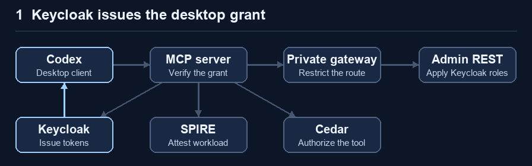

# Keycloak MCP security reference (experimental)

Keycloak authenticates the user, SPIRE attests the MCP workload, and Cedar
decides whether a tool may run. The workload exchanges the user's grant for a
short-lived credential scoped to the permitted Admin operation.



[Interactive guide](https://github.com/gaelnite/keycloak-mcp-security-demo/blob/main/docs/mcp-auth-evolution.html) · Open the HTML locally to step through an allowed read, an approved write, and a missing-scope denial.

The Docker demo uses Keycloak 26.8.2 with its **preview SPIFFE feature**. It
pre-registers the desktop client. Dynamic Client ID Metadata Document (CIMD)
admission belongs to the separate 26.8.1 lab.

The OAuth SPIFFE and CIMD texts are Internet-Drafts. The example runs on a single
trusted host with synthetic realm data.
[Security model](docs/SECURITY.md)
[Keycloak feature definitions](https://github.com/keycloak/keycloak/blob/26.8.2/common/src/main/java/org/keycloak/common/Profile.java)
[SPIFFE draft](https://datatracker.ietf.org/doc/draft-ietf-oauth-spiffe-client-auth/03/)
[CIMD draft](https://datatracker.ietf.org/doc/draft-ietf-oauth-client-id-metadata-document/03/)

## Run the delegated demo

From the repository root, use Docker with Compose v2 and a free loopback port.
The command below uses the same project and HTTPS port as the delegation runbook.

```sh
KC_MCP_DEMO_PORT=49448 docker compose -p keycloak-mcp-delegated \
  -f deploy/docker/compose.yaml \
  -f deploy/docker/compose.interactive.yaml \
  -f deploy/docker/compose.delegated.yaml \
  up --build -d --wait
```

The MCP endpoint is `https://localhost:49448/mcp`.

Follow the runbook to export the installation's CA, sign in and verify an allowed read. The installer creates
demo passwords for each installation.
[Delegation runbook](docs/MCP-DELEGATION.md)
[Desktop sign-in and scope selection](docs/MCP-INTERACTIVE.md)

| Demo role | Scopes the user may select |
| --- | --- |
| Helpdesk | `keycloak.users.read` |
| Realm administrator | `keycloak.users.read`, `keycloak.clients.read`, `keycloak.users.locale.write` |

Users can select any subset of the scopes their role allows. If they select
none, the desktop client shows no tools from this MCP server. In the delegated
profile, a realm admin can change the language preference of a designated
disabled test account. Each attempt requires a fresh approval from an operator.

## Follow one tool call

1. **Desktop grant.** Codex uses authorization code with S256 PKCE and an exact
   loopback callback. Keycloak issues an MCP access token for the user's selected
   scopes and eligible exchange clients. [MCP OAuth](docs/MCP-OAUTH.md)
2. **Tool authorization.** MCP verifies the token and checks the tool against the
   selected scope, entitlement and deployment configuration. Cedar evaluates
   the verified user, tool and realm. [Cedar authorization](docs/AUTHZ.md)
3. **Workload authentication.** For an allowed Admin call, MCP obtains a fresh
   JWT-SVID from SPIRE. It authenticates to Keycloak as the capability's exchange
   client and requests a distinct Admin token for the same user. [Delegation](docs/MCP-DELEGATION.md)
4. **Admin operation.** MCP validates the exchanged token before sending it to the
   private gateway. The gateway restricts the method, route and query. Keycloak
   checks backend permissions and MCP returns only the documented response fields.
   [Keycloak 26.8.2 results](docs/delivery/keycloak-26.8.2.md)

## Other entry points

| To explore | Start here |
| --- | --- |
| Attested headless access and a Cedar smoke test | [Headless Docker demo](docs/DOCKER.md) |
| Role-scoped desktop discovery with Admin dispatch disabled | [Interactive profile](docs/MCP-INTERACTIVE.md) |
| Script-issued SVIDs, dynamic CIMD and the legacy token-passthrough profile | [Podman deployment](docs/DEPLOYMENT.md) and [26.8.1 results](docs/AUTHN-RESULTS.md) |
| Local tests, policy validation and contribution process | [Contributing](CONTRIBUTING.md) |
| Trust assumptions, limitations and vulnerability reporting | [Security model](docs/SECURITY.md) and [security policy](SECURITY.md) |

The MCP HTTP discovery and challenge implementation targets the 2026-07-28
authorization specification. The recorded SDK session negotiated protocol version
`2025-11-25`. [MCP authorization specification](https://modelcontextprotocol.io/specification/2026-07-28/basic/authorization)

## Credits and license

The Cedar integration draws on the PEP/PDP pattern in
[openclaw-cedar-policy-demo](https://github.com/windley/openclaw-cedar-policy-demo).
See the [third-party notices](NOTICE), [extension review](docs/EXTENSIONS.md)
and [Apache 2.0 license](LICENSE).
